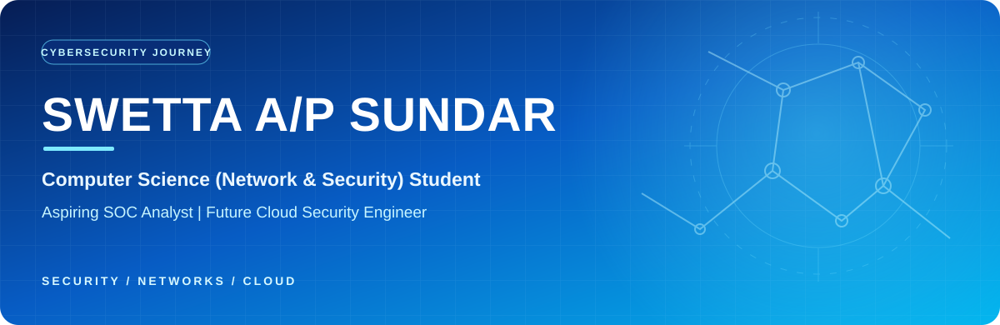

---

## 01 / About Me

Hello! I'm **Swetta**, a first-year **Bachelor of Computer Science (Network & Security)** student at **Universiti Teknologi Malaysia (UTM)**, previously from **Kolej Matrikulasi Perak**.

I'm curious about how networks work, how threats are identified, and how digital systems can be protected.

My immediate goal is to become a **Security Operations Center (SOC) Analyst**, and I hope to progress into **Cloud Security Engineering** as I gain experience.

- **Currently:** Building my foundation in programming, logic, and computing systems.
- **Interested in:** Cybersecurity, network security, threat detection, and security monitoring.
- **What drives me:** Learning consistently, solving problems, and working with others.

---

## 02 / Technical Toolkit

### Programming Languages

### Computing Foundations

My technical skills are still developing. I'm focused on understanding the fundamentals before moving into more advanced tools and security practices.

---

## 03 / Current Learning Dashboard

| University Subject | Learning Focus |
|:--|:--|
| **Programming Technique** | C++ fundamentals and problem-solving |
| **Digital Logic** | Logic gates, circuits, and Boolean algebra |
| **Discrete Structure** | Sets, logic, and mathematical reasoning |
| **Technology and Information Systems** | Computing systems and information technology |
| **Cybersecurity Fundamentals** | Security concepts and defensive security |

### Security Topics I Want to Explore

- Network traffic analysis and monitoring
- Threat detection and security operations
- Incident response fundamentals
- Cloud infrastructure and security

---

## 04 / Milestones Beyond the Code

### Innovation & Impact

- **INNOVEX 2026:** Gold Award recipient.
- **4Flat4Everyone:** Developed a mathematics learning website that reached over **200 users**.

### Academic & Organisational Leadership

- **PAL Supremo (Mathematics):** Supported peer-assisted mathematics learning.
- **High Council (Exco Matematik Asas):** Contributed to academic leadership.
- **Assistant Treasurer – VIBEs:** Held an organisational finance responsibility.
- **Head Prefect:** Built communication, teamwork, and leadership experience.
- **Duta Sahsiah Karamah Insaniah:** Received recognition for character and leadership.

---

## 05 / Career Roadmap

| NOW | NEXT GOAL | LONG-TERM VISION |
|:--:|:--:|:--:|
| **CS Student** | **SOC Analyst** | **Cloud Security Engineer** |
| Programming & networking foundations | Monitoring & threat detection | Securing cloud environments |
| **BUILD** | **DEFEND** | **SECURE** |

- **Stage 01 — Building Foundations:** Programming, digital logic, networking concepts, and cybersecurity fundamentals.
- **Stage 02 — SOC Analyst:** Develop skills in security monitoring, threat detection, and incident investigation.
- **Stage 03 — Cloud Security Engineer:** Grow toward cloud infrastructure protection, identity management, and security architecture.

---

## 06 / GitHub Activity

*Language cards reflect public repository contents, not overall proficiency. External statistics services may occasionally be unavailable.*

---

## 07 / Beyond the Terminal

- **Bharatanatyam:** Creativity, discipline, and expression through dance.
- **Cooking:** A creative outlet outside university life.
- **Leadership:** Working with others and taking responsibility.
- **Continuous learning:** Staying curious and open to new challenges.

---

## 08 / Connect With Me

### Learning Today, Securing Tomorrow.

*Built with curiosity. Driven by purpose.*

**SWETTA A/P SUNDAR**

